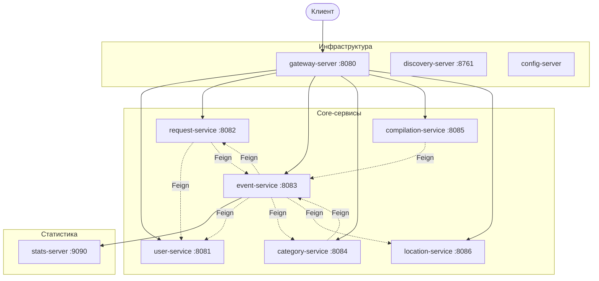

<div align="center">

# 🧭 Explore With Me

**Платформа для публикации мероприятий и поиска компании для участия в них**


</div>

Проект построен как набор микросервисов на Spring Cloud. Каждый домен (пользователи, события, заявки, категории, подборки, места) живёт в отдельном сервисе со своей базой данных. Общение между сервисами идёт через Feign-клиенты с защитой от сбоев на Resilience4j.

---

## 📑 Содержание

1. [Технологии](#-технологии)
2. [Архитектура](#-архитектура)
3. [Структура репозитория](#-структура-репозитория)
4. [Сервисы и порты](#-сервисы-и-порты)
5. [Маршрутизация через Gateway](#-маршрутизация-через-gateway)
6. [Сервис статистики](#-сервис-статистики)
7. [Отказоустойчивость](#-отказоустойчивость)
8. [Функциональность Locations](#-функциональность-locations)
9. [Быстрый старт](#-быстрый-старт)
10. [Сборка и качество кода](#-сборка-и-качество-кода)
11. [Документация API](#-документация-api)
12. [Дорожная карта](#-дорожная-карта-рекомендательная-система)

---

## 🛠 Технологии

| Область | Стек |
|---|---|
| Язык и сборка | Java 21, Maven (многомодульный проект) |
| Фреймворк | Spring Boot 3.3.0, Spring Cloud 2023.0.3 |
| Инфраструктура | Eureka, Spring Cloud Config (native), Spring Cloud Gateway |
| Взаимодействие | OpenFeign (+ `feign-hc5` для PATCH), Spring Cloud LoadBalancer |
| Отказоустойчивость | Resilience4j 2.2.0 (CircuitBreaker, Retry) |
| Данные | PostgreSQL 16.1, Spring Data JPA, Spring JDBC (stats), H2 для тестов |
| Прочее | Lombok, Checkstyle, Actuator, Docker Compose |

---

## 🏗 Архитектура



> Все сервисы регистрируются в Eureka и получают конфигурацию от config-server. На схеме эти связи опущены для читаемости.

**Ключевые принципы**

- **База на сервис.** Прямых обращений в чужие БД нет. Вместо JPA-связей между доменами хранятся только идентификаторы (`initiator_id`, `category_id`, `place_id`, `event_id`, `requester_id`), а данные соседей запрашиваются через Feign.
- **Внутренний API.** Эндпоинты `/internal/**` — приватный контракт между сервисами. Через Gateway они не публикуются.
- **Модули `*-dto` / `*-client` / `*-server`.** DTO и Feign-клиент вынесены в отдельные артефакты, поэтому сервисы зависят друг от друга только через контракт.
- **Batch-запросы.** Для списков событий инициаторы, категории и количества подтверждённых заявок запрашиваются одним вызовом (без проблемы N+1).

---

## 📁 Структура репозитория

```text
.
├── pom.xml                       родительский POM
├── docker-compose.yml
├── checkstyle.xml
├── ewm-main-service-spec.json    OpenAPI основного API
├── ewm-stats-service-spec.json   OpenAPI сервиса статистики
│
├── infra/
│   ├── discovery-server/         Eureka Server
│   ├── config-server/            Spring Cloud Config (config/*.properties)
│   └── gateway-server/           Spring Cloud Gateway
│
├── stat/
│   ├── stat-dto/                 HitDto, StatDto
│   ├── stat-client/              клиент статистики (через Eureka)
│   └── stats-server/             сервис статистики
│
└── core/
    ├── user/                     user-dto, user-client, user-server
    ├── event/                    event-dto, event-client, event-server
    ├── request/                  request-dto, request-client, request-server
    ├── category/                 category-dto, category-client, category-server
    ├── compilation/              compilation-server
    └── place/                    place-dto, place-client, place-server
```

---

## 🔌 Сервисы и порты

Порты указаны для запуска через Docker Compose. Локально сервисы стартуют на случайном порту (`server.port=0`) и находят друг друга через Eureka.

| Сервис | Назначение | Порт | База данных | Порт БД на хосте |
|---|---|:---:|---|:---:|
| `discovery-server` | Eureka | 8761 | — | — |
| `config-server` | Конфигурация | случайный | — | — |
| `gateway-server` | Единая точка входа | **8080** | — | — |
| `user-service` | Пользователи | 8081 | `ewm-users` | 6543 |
| `request-service` | Заявки на участие | 8082 | `ewm-requests` | 6544 |
| `event-service` | События | 8083 | `ewm-events` | 6545 |
| `category-service` | Категории | 8084 | `ewm-category` | 6546 |
| `compilation-service` | Подборки событий | 8085 | `ewm-compilation` | 6547 |
| `location-service` | Справочник мест | 8086 | `ewm-location` | 6548 |
| `stats-server` | Статистика просмотров | 9090 | `ewm-stats` | 6541 |

---

## 🚪 Маршрутизация через Gateway

Внешний API доступен на `http://localhost:8080`.

| Путь | Сервис |
|---|---|
| `/admin/users/**` | `user-service` |
| `/users/{userId}/requests/**` | `request-service` |
| `/events/**`, `/admin/events/**`, `/users/{userId}/events/**` | `event-service` |
| `/categories/**`, `/admin/categories/**` | `category-service` |
| `/places/**`, `/admin/places/**` | `location-service` |
| `/compilations/**`, `/admin/compilations/**` | `compilation-service` |

---

## 📊 Сервис статистики

Сохраняет обращения к эндпоинтам и отдаёт агрегированную статистику.

| Метод | Путь | Описание |
|---|---|---|
| `POST` | `/hit` | Сохранить обращение (`app`, `uri`, `ip`, `timestamp`), ответ `201` |
| `GET` | `/stats` | Статистика за период |

Параметры `GET /stats`:

| Параметр | Обязательный | Описание |
|---|:---:|---|
| `start`, `end` | да | Границы периода, формат `yyyy-MM-dd HH:mm:ss` |
| `uris` | нет | Список URI для выборки |
| `unique` | нет | `true` — считать только уникальные IP (по умолчанию `false`) |

Клиент `stat-client` находит `stats-server` через Eureka, делает 3 попытки с нарастающей задержкой и поддерживает таймаут (`stat-client.timeout-ms`). `event-service` отправляет hit при просмотре публичных эндпоинтов событий и запрашивает количество просмотров. Если статистика недоступна, события всё равно возвращаются, а `views` равно `null`.

---

## 🛡 Отказоустойчивость

Вызовы соседей обёрнуты в отдельные бины-шлюзы (`UserGateway`, `CategoryGateway`, `PlaceGateway`, `RequestGateway`, `EventGateway`) с аннотациями `@CircuitBreaker` и `@Retry`.

> [!NOTE]
> Шлюзы вынесены в отдельные классы намеренно: аннотации Resilience4j работают через Spring AOP-прокси и не срабатывают при вызове метода внутри того же класса.

Поведение при недоступности зависимости зависит от типа операции:

| Операция | Поведение |
|---|---|
| Чтение для отображения (инициатор, категория, место, число заявок) | **Деградация:** заглушка, `null` или `0`, ответ не падает |
| Запись и валидация (создание события, подача заявки, подтверждение заявок, удаление категории) | **Fail-closed:** `503 Service Unavailable` |
| Бизнес-ответы соседа (`404`, `409`) | Пробрасываются как есть и не считаются сбоем для circuit breaker |

Параметры circuit breaker и retry задаются в `application.properties` каждого сервиса, таймауты Feign — через `feign.client.config.default.*`.

---

## 📍 Функциональность Locations

Справочник мест вынесен в `location-service` (поля `id`, `name`, `lat`, `lon`). Событие хранит только `place_id`.

### Справочник мест

| Доступ | Метод и путь | Описание |
|---|---|---|
| Public | `GET /places` | Список мест |
| Public | `GET /places/{placeId}` | Место по id |
| Admin | `POST /admin/places` | Создать место |
| Admin | `PUT /admin/places/{placeId}` | Изменить место |
| Admin | `DELETE /admin/places/{placeId}` | Удалить место |

### Привязка места к событию

Привязка выполняется отдельными эндпоинтами, а не через PATCH события: общий подход к update-DTO игнорирует `null`-поля, поэтому явно сбросить привязку через PATCH нельзя.

| Доступ | Метод и путь | Ограничения |
|---|---|---|
| Private | `PUT /users/{userId}/events/{eventId}/place/{placeId}` | Только статусы `PENDING`, `CANCELED` |
| Private | `DELETE /users/{userId}/events/{eventId}/place` | Только статусы `PENDING`, `CANCELED` |
| Admin | `PUT /admin/events/{eventId}/place/{placeId}` | Без ограничений |
| Admin | `DELETE /admin/events/{eventId}/place` | Без ограничений |

### Поиск событий по месту

Параметры `placeId` и `radius` доступны в `GET /events` и `GET /admin/events`:

```http
GET /events?placeId=1              # события, привязанные к месту
GET /events?placeId=1&radius=2     # события в радиусе 2 км от места
```

> [!IMPORTANT]
> Радиус без места — ошибка `400`. Расстояние считается SQL-функцией `distance(...)` (PL/pgSQL), которая создаётся в `schema.sql` event-service, поэтому для поиска по радиусу нужен PostgreSQL.

---

## 🚀 Быстрый старт

**Требования:** JDK 21, Maven 3.9+, Docker и Docker Compose.

### Через Docker Compose

Dockerfile каждого сервиса копирует `target/*.jar`, поэтому сначала соберите проект:

```bash
mvn clean package -DskipTests
docker compose up --build
```

Gateway стартует после того, как healthcheck пройдут все core-сервисы. После запуска доступны:

| Что | Адрес |
|---|---|
| API | <http://localhost:8080> |
| Eureka | <http://localhost:8761> |
| Статистика | <http://localhost:9090> |

### Локальный запуск без Docker

<details>
<summary>Показать шаги</summary>

1. Поднимите PostgreSQL и создайте базы:
   `ewm-stats`, `ewm-users`, `ewm-requests`, `ewm-events`, `ewm-category`, `ewm-compilation`, `ewm-location`.
2. Параметры подключения по умолчанию (`dbuser` / `12345`, `localhost:5432`) заданы в `application.properties` сервисов. Переопределить их можно переменными `SPRING_DATASOURCE_URL`, `SPRING_DATASOURCE_USERNAME`, `SPRING_DATASOURCE_PASSWORD`.
3. Запускайте сервисы в таком порядке:
   `discovery-server` → `config-server` → остальные сервисы → `gateway-server`.

Таблицы создаются автоматически из `schema.sql` каждого сервиса (`spring.sql.init.mode=always`).

</details>

---

## ✅ Сборка и качество кода

```bash
mvn clean verify
```

- **Checkstyle** подключён в родительском POM (фаза `compile`, `failOnViolation=true`), правила в `checkstyle.xml`.
- **Тесты** запускаются с профилем `test` (H2 в режиме PostgreSQL).
- **CI:** workflow `.github/workflows/api-tests.yml` запускает Postman-тесты, отчёт строится по шаблону `dashboard-template.hbs`.

---

## 📚 Документация API

Спецификации OpenAPI лежат в корне репозитория. Открыть их можно в [Swagger Editor](https://editor.swagger.io/).

| Файл | Содержимое |
|---|---|
| `ewm-main-service-spec.json` | Основной API: события, категории, подборки, пользователи, заявки |
| `ewm-stats-service-spec.json` | API сервиса статистики |

---

## 🗺 Дорожная карта: рекомендательная система

Следующий этап — замена простого сервиса статистики на рекомендательную систему на базе Apache Kafka и gRPC.

> [!NOTE]
> Этот этап ещё не реализован, раздел описывает планируемую работу.

### Новые сервисы

| Сервис | Задача |
|---|---|
| **Collector** | Принимает действия пользователей (просмотр, заявка, лайк) по gRPC и пишет в топик `stats.user-actions.v1` в формате Avro |
| **Aggregator** | Читает действия, пересчитывает косинусное сходство мероприятий и пишет результат в `stats.events-similarity.v1` |
| **Analyzer** | Хранит историю взаимодействий и коэффициенты сходства, по gRPC отдаёт рекомендации, похожие мероприятия и суммы взаимодействий |

### Изменения в существующих сервисах

| Сервис | Изменение |
|---|---|
| `event-service` | Поле `views` заменяется на `rating` (`double`) из Analyzer |
| `event-service` | `GET /events/{id}` отправляет в Collector просмотр, пользователь берётся из заголовка `X-EWM-USER-ID` |
| `event-service` | Новые эндпоинты `GET /events/recommendations` и `PUT /events/{eventId}/like` (лайк только для посещённых событий, иначе `400`) |
| `request-service` | `POST /users/{userId}/requests` отправляет в Collector информацию о регистрации |
| `stat-client` | gRPC-клиенты к Collector и Analyzer |
| `docker-compose` | Запуск Kafka и создание топиков `stats.user-actions.v1`, `stats.events-similarity.v1` |
